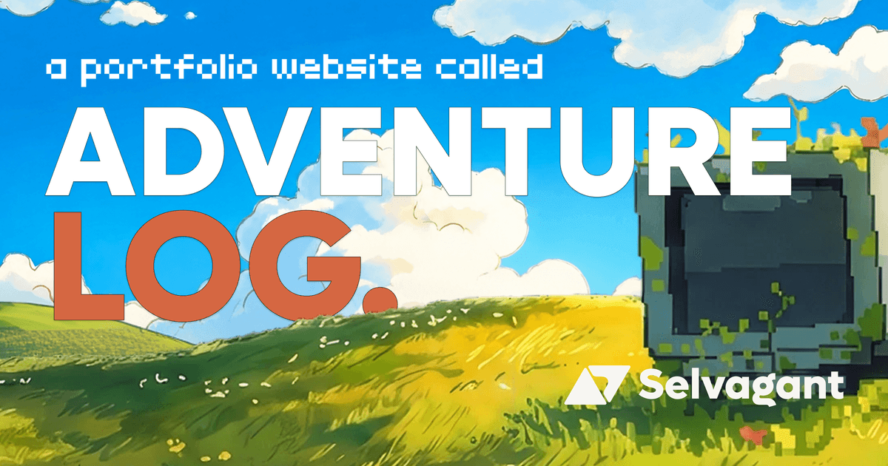

# 🧭 Adventure Log — Digital Field Journal

<p align="center">
  
</p>

> **"A field journal where precision engineering meets organic exploration."**  
> Digital Field Journal & Engineering Portfolio of **Syafiq Abiyyu Taqi (Taki)** — Software Developer & Builder specializing in Fullstack Web, Applied AI, and Developer Tools.

---

## 🌟 Key Highlights

- **Tactical Cartography Aesthetic**: Cutout notch dock with inverted rounded ears, live Asia/Jakarta (WIB) telemetry clock, geographic coordinates, and tactile paper grain overlay.
- **Interactive 3D Stage**: Three.js compass viewport (`HeroCompass3D`) with dynamic camera parallax, atmospheric lighting, and procedural materials.
- **Curated Expeditions**: Detailed showcase for production projects including XHTML Reader Previewer (VS Code & Antigravity Extension), Kagu Voice AI (Browser Extension), NoteCraft (Flutter mobile game), and DBS Foundation Computer Vision Fatigue Screening Tool.
- **Field Arsenal**: Structured technical capability matrix across 3 core pillars:
  - `01` **Fullstack Web Systems** (React 19, TypeScript, Node.js, Express, PostgreSQL, REST APIs)
  - `02` **Applied AI & Machine Learning** (Gemini Live API, Whisper, MediaPipe CV, Local SLMs)
  - `03` **Developer Tooling & Extensions** (VS Code Webviews, WXT, Manifest V3, EPUB3 & OPF standards)
- **Field Dossier & ATS Resume**: Interactive modal resume viewer with synced career data and one-click download for a single-page ATS-formatted PDF resume (`resume-syafiq-abiyyu-taqi.pdf`).
- **Privacy Telemetry**: Lightweight, privacy-first analytics powered by Umami.

---

## 🛠️ Tech Stack & Architecture

- **Core Framework**: React 19, TypeScript, & Vite 8
- **3D Graphics & Canvas**: Three.js (dynamic lighting, custom geometry, lazy-loaded chunking)
- **Animation Engine**: GSAP (GreenSock) & ScrollToPlugin
- **Styling Architecture**: Vanilla CSS with structured design tokens (`tokens.css`, `global.css`, `fonts.css`)
- **Typography**: `Lufga` (Display), `Newsreader` (Editorial Serif), `Printvetica` (Brutalist Technical Display), and `JetBrains Mono` (Telemetry & Code)
- **Code Quality & Linter**: Oxlint & TypeScript project references (`tsc -b`)

---

## 📁 Project Structure

```
adventure-log/
├── public/
│   ├── fonts/                         # Optimized WOFF2 font assets
│   ├── images/                        # Background landscapes & expedition mockups
│   ├── logo/                          # Scalable SVG brand assets
│   ├── resume-syafiq-abiyyu-taqi.pdf  # 1-page ATS formatted resume
│   ├── og-image.png                   # 1200x630 social share card
│   ├── noise.svg                      # Tactile paper grain filter
│   └── favicon.svg                    # Cartographer compass mark
├── src/
│   ├── assets/                        # Static UI icons & vector assets
│   ├── components/                    # Modular UI components
│   │   ├── ui/                        # Reusable presentation widgets
│   │   │   ├── AccordionGallery.tsx   # Expandable project gallery cards
│   │   │   ├── DepthCarousel.tsx      # Tactile depth preview carousel
│   │   │   └── PixelSwap.tsx          # Canvas pixel scramble effect
│   │   ├── Preloader.tsx              # Asset readiness counter & curtain reveal
│   │   ├── TacticalNav.tsx            # Floating tactile navigation rail
│   │   ├── Header.tsx                 # Telemetry notch dock & coordinates
│   │   ├── Hero.tsx                   # Opening hero narrative
│   │   ├── HeroCompass3D.tsx          # Interactive 3D Three.js compass
│   │   ├── About.tsx                  # Profile polaroid, dossier button & narrative
│   │   ├── ProfileDossierModal.tsx    # Resume modal viewer & PDF downloader
│   │   ├── SelectedExpeditions.tsx    # Project catalog with category filters
│   │   ├── FieldArsenal.tsx           # 3-pillar technical capability matrix
│   │   ├── Footer.tsx                 # Colophon footer & depth landscape stage
│   │   └── TargetCursor.tsx           # Custom crosshair tactical cursor
│   ├── data/                          # Typed static dataset (arsenal, expeditions)
│   ├── hooks/                         # Viewport, telemetry, & interaction hooks
│   ├── styles/                        # Modular tokens, reset, & typography
│   ├── types/                         # TypeScript domain contracts
│   ├── App.tsx                        # Root layout orchestrator
│   └── main.tsx                       # React application entrypoint
```

---

## 🚀 Getting Started

### 1. Prerequisites
- Node.js 20+ (recommended LTS)
- npm 10+

### 2. Installation
Clone the repository and install dependencies:
```bash
git clone https://github.com/intxdv/adventure-log.git
cd adventure-log
npm install
```

### 3. Development
Start the local development server:
```bash
npm run dev
```
Open `http://localhost:5173` in your browser.

### 4. Linting
Run static code analysis using Oxlint:
```bash
npm run lint
```

### 5. Production Build
Compile TypeScript and build the production bundle:
```bash
npm run build
```

Preview the production build locally:
```bash
npm run preview
```

---

## 📄 License & Attribution

- Built and maintained by [Syafiq Abiyyu Taqi (Taki)](https://github.com/intxdv).
- © 2026 Syafiq Abiyyu Taqi. **All Rights Reserved**. See [LICENSE](LICENSE) for details.
